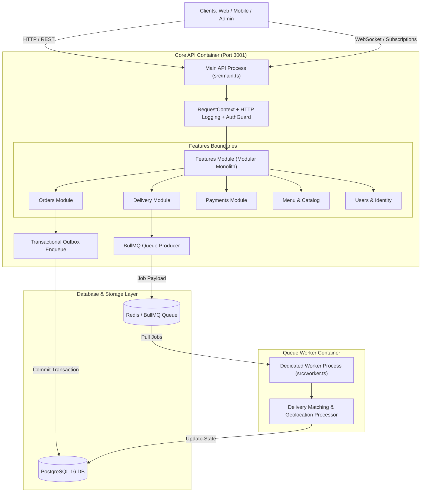

# BÁO CÁO ĐÁNH GIÁ TOÀN DIỆN & KHÁCH QUAN: HỆ THỐNG FOODEE CORE-API

> **Dự án:** Food Delivery Platform (`core-api`)  
> **Phiên bản:** `0.0.1`  
> **Framework:** NestJS 11, TypeScript, TypeORM, PostgreSQL, Redis, BullMQ, GraphQL (Apollo), Docker  
> **Người đánh giá:** Senior Principal Software & System Architect  
> **Thời điểm đánh giá:** Tháng 10/2026  
> **Trạng thái xác thực tự động thực tế:**
> - `npm run build`: **PASSED (Exit code 0)**
> - `npm run test:unit`: **PASSED (119 test suites, 421 tests passed, 0 failures)**
> - `npm run test:integration`: **PASSED (26 test suites, 78 tests passed, 0 failures)**
> - `npm run lint`: **PASSED (0 errors, 122 warnings sau khi auto-fix)**

---

## I. TỔNG QUAN ĐIỂM SỐ & RADAR ĐÁNH GIÁ (EXECUTIVE SCORECARD)

Dựa trên việc kiểm tra toàn bộ mã nguồn, các ca kiểm thử tự động, kiến trúc thư mục, quy tắc ràng buộc biên giới mô-đun (Architectural Boundaries), bảo mật, cơ sở dữ liệu và hạ tầng hàng đợi; hệ thống `core-api` được chấm điểm theo thang chuẩn quốc tế dành cho kiến trúc doanh nghiệp:

| Tiêu chí Đánh giá | Trọng số | Điểm số (Thang 10) | Nhận xét nhanh |
| :--- | :---: | :---: | :--- |
| **1. Kiến trúc hệ thống & Thiết kế mô-đun** | 20% | **9.2 / 10** | Modular Monolith mẫu mực; phân tách Public API rõ ràng; worker độc lập hoàn toàn. |
| **2. Toàn vẹn nghiệp vụ & Mô hình dữ liệu** | 20% | **8.8 / 10** | Áp dụng Transactional Outbox, State Machine chặt chẽ, server-side pricing bảo vệ chống gian lận. |
| **3. Kiểm thử & Quản trị kiến trúc tự động** | 15% | **9.5 / 10** | Xuất sắc. 421 unit tests; dùng custom ESLint rules kèm test assertion để khóa kiến trúc. |
| **4. Hạ tầng bất đồng bộ & Hàng đợi (Queue/Worker)** | 15% | **8.5 / 10** | BullMQ + Redis được bọc cách ly; có Dead-letter, retry backoff và fallback an toàn. |
| **5. Bảo mật & Kiểm soát truy cập (Security/RBAC)** | 10% | **7.8 / 10** | RBAC chi tiết, Production Config Guard tốt; thiếu Rate Limiting (`@nestjs/throttler`) và phân giải cache quyền. |
| **6. Hiệu năng & Khả năng mở rộng (Scalability)** | 10% | **7.5 / 10** | In-memory PubSub GraphQL chưa phân tán (cần Redis PubSub); query permissions bị gọi lặp lại. |
| **7. Tiêu chuẩn mã nguồn & Kỷ luật TypeScript** | 10% | **8.2 / 10** | Cấu trúc code sạch, DI chuẩn NestJS; điểm trừ do bật `noImplicitAny: false` dẫn đến nhiều `any`. |
| **TỔNG ĐIỂM TRỌNG SỐ (OVERALL)** | **100%** | **8.6 / 10** | **Xếp loại: VERY GOOD (Cận mức Production-Ready cấp Doanh nghiệp)** |

---

## II. ĐÁNH GIÁ CHI TIẾT KIẾN TRÚC HỆ THỐNG (SYSTEM ARCHITECTURE)

### 1. Điểm xuất sắc (Strengths)
1. **Kiến trúc Modular Monolith chuẩn chỉ:**
   - Mã nguồn không bị phân mảnh theo kiểu Spaghetti mà chia theo các Domain Feature rõ ràng (`orders`, `delivery`, `payments`, `menu`, `locations`, `notifications`, `users`).
   - Mỗi feature chỉ công khai interface ra ngoài thông qua file `public-api.ts`. Các module khác chỉ được phép giao tiếp qua các Service xuất khẩu từ `public-api.ts`.
2. **Khóa vi phạm kiến trúc bằng ESLint và Unit Test (Architecture Governance as Code):**
   - Dự án đã cài đặt một cơ chế kiểm soát kiến trúc hiếm thấy ở các dự án thông thường: sử dụng custom ESLint rules (`foodee-boundaries/feature-import-boundaries`, `foodee-boundaries/no-foreign-legacy-entity-import`, `foodee-boundaries/no-forward-ref`, `foodee-boundaries/no-duplicate-module-providers`).
   - Các quy tắc này ngăn ngừa triệt để:
     - Không cho phép module A tự ý import Entity / Repository trực tiếp của module B.
     - Cấm lạm dụng `forwardRef` (nguồn cơn của circular dependency memory leak).
     - Kiểm tra toàn bộ bằng suite `test/integration/architecture-boundaries.spec.ts`.
3. **Tách biệt hoàn toàn Process API và Process Worker:**
   - `src/main.ts` khởi động HTTP REST & GraphQL server, chỉ sản xuất (produce) background job chứ không consume.
   - `src/worker.ts` chạy riêng `WorkerModule`, chỉ load duy nhất các dependency cần thiết cho giao vận và queue processing, hoàn toàn không load Controller, HTTP filter, Swagger hay cổng thanh toán. Điều này tối ưu hóa bộ nhớ và giúp scale worker độc lập khi lượng đơn tăng vọt.
4. **Pattern Đảm bảo Tính Nhất quán Dữ liệu (Transactional Outbox Pattern):**
   - Trong quá trình tạo đơn hàng (`order-creation.service.ts`), sự kiện `ORDER_CREATED_EVENT` được ghi vào bảng `outbox_events` **bên trong cùng database transaction** với đơn hàng.
   - Khi database commit thành công thì event mới được dispatch ra ngoài. Nếu crash giữa chừng, transaction rollback và không bao giờ xảy ra tình trạng "sự kiện đã bắn đi mà đơn hàng chưa lưu".

---

## III. ĐÁNH GIÁ CHI TIẾT TỪNG PHÂN HỆ NGHIỆP VỤ (DOMAIN LOGIC AUDIT)

### 1. Phân hệ Đặt hàng (Orders) - Đánh giá: 9.0 / 10
- **Server-Side Pricing Validation:** Toàn bộ công thức giá, toppings, phí vận chuyển và mã giảm giá đều được tính toán lại 100% tại backend thông qua `OrderPricingService`. Người dùng không thể can thiệp payload giá từ client.
- **State Machine Nghiêm ngặt:** Có `OrderStateMachine` định nghĩa ma trận chuyển đổi trạng thái hợp lệ (`PENDING` -> `PREPARING` -> `READY_FOR_DELIVERY` -> `ASSIGNED` -> `DELIVERED`). Ngăn chặn chuyển đổi trạng thái phi lý (ví dụ: đã hủy lại giao thành công).
- **Tích hợp Bản đồ & Địa lý:** Tính khoảng cách giao nhận bằng Mapbox SDK với fallback thông minh về thuật toán Haversine nếu dịch vụ ngoài gặp sự cố hoặc timeout.

### 2. Phân hệ Giao vận & Ghép cuốc (Delivery & Dispatch) - Đánh giá: 8.8 / 10
- **Cơ chế Giữ cuốc độc quyền (Hold Timeout 2 phút):** Sử dụng `RedisPendingAssignmentStore` để tài xế có 120 giây xác nhận nhận đơn. Tránh xung đột 2 tài xế cùng nhận 1 đơn.
- **Quản lý Concurrency:** Job `FindShipperProcessor` được thiết lập `concurrency: 1` và có các ca test kiểm tra đồng thời (`shipping-detail.concurrency.integration.spec.ts`), đảm bảo không bị race-condition khi ghi nhận trạng thái chuyến đi.

### 3. Phân hệ Thanh toán & Đối soát (Payments) - Đánh giá: 8.7 / 10
- **Mô hình Trừu tượng Đa Cổng (Gateway Router Strategy):** Thiết kế `PaymentGatewayRouter` hỗ trợ linh hoạt Momo, VNPay, ZaloPay, Tiền mặt (COD) và Mock Provider.
- **Bảo mật Webhook:** Endpoint `POST /payment/webhook` bắt buộc header `x-payment-signature`. Hệ thống kiểm tra chữ ký HMAC SHA256 hoặc thuật toán tương đương trước khi xác nhận tiền vào hệ thống.
- **Bảng Idempotency:** Lưu vết giao dịch để không bị xử lý trùng lặp (double-crediting) khi các cổng thanh toán gửi lại webhook nhiều lần.
- **Có sẵn Dịch vụ Đối soát (`PaymentReconciliationService`):** Tự động phát hiện các khoản thanh toán treo để hoàn trả hoặc đồng bộ trạng thái.

### 4. Phân hệ Định danh, Người dùng & Phân quyền (Users & Auth) - Đánh giá: 7.8 / 10
- **Phân quyền Role & Resource Permissions:** Hệ thống phân quyền rất chi tiết (`USER`, `MERCHANT`, `SHIPPER`, `ADMIN`), kiểm tra quyền thông qua `@Permissions('...')` và `RolesGuard`.
- **Hạn chế kỹ thuật phát hiện được:**
  - Trong `RolesGuard.ts`, hàm `getUserPermissionStrings(userId)` gọi `this.userService.findOne(userId)` đi kèm relation `role` và `role.permissions`.
  - **Vấn đề:** Thao tác này truy vấn SQL trực tiếp vào PostgreSQL cho **mỗi HTTP request** có bảo vệ quyền. Dưới tải lớn (concurrency cao), đây sẽ là điểm nghẽn cổ chai (database bottleneck). Cần chuyển sang lưu quyền trong Redis hoặc mã hóa permission claims trong JWT token.

---

## IV. BẢO MẬT & HẠ TẦNG SẴN SÀNG (SECURITY & DEPLOYMENT)

### 1. Điểm sáng về An toàn thông tin
1. **Production Configuration Guard (`production-config.guard.ts`):**
   - Khi `NODE_ENV === 'production'`, hàm kiểm tra ngăn chặn ngay lập tức nếu các secret quan trọng (`JWT_SECRET`, `DB_PASSWORD`, `MINIO_SECRET_KEY`) chứa giá trị mặc định (`changeme`, `password`, `123456`, `your_secret_key`).
   - Tự động chặn chạy cổng thanh toán demo `ENABLE_DEMO_PAYMENT` trên môi trường thật.
2. **Che giấu chi tiết lỗi nhạy cảm (`ApiExceptionFilter.ts`):**
   - Với các lỗi mã 500 (Internal Server Error), filter chuyển thành thông điệp chuẩn `"Internal server error"`, loại bỏ hoàn toàn SQL query error, stack trace hay bảng dữ liệu nội bộ gửi về client.
   - Gắn `X-Request-Id` để phục vụ tracing log khi cần tra cứu lỗi.
3. **CORS Cấu hình chặt chẽ:** Kiểm soát qua `allowedCorsOrigins()`, cấm wildcard `*` khi deploy production.
4. **Container Docker an toàn:** Multi-stage build `node:20-alpine`, tạo user phi quyền root (`nestjs:nodejs`) để chạy process.

### 2. Các điểm hạn chế & Lỗ hổng cần khắc phục ngay
1. **Thiếu Rate Limiting ở tầng ứng dụng (Application Layer DoS Protection):**
   - Chưa tích hợp `@nestjs/throttler`.
   - Các API nhạy cảm như Đăng nhập, Gửi OTP, Tính tiền đơn hàng (`calculateOrder`), Tìm kiếm menu hiện tại không bị giới hạn tần suất gọi từ 1 IP. Cần bổ sung ngay `@nestjs/throttler` kết hợp Redis store.
2. **In-Memory PubSub trong GraphQL Subscriptions:**
   - File `src/pubsub.ts` hiện đang dùng `new PubSub()` từ thư viện `graphql-subscriptions`.
   - Đây là in-memory PubSub. Nếu triển khai hệ thống trên cụm Kubernetes hoặc chạy nhiều container API đằng sau Load Balancer, các subscription qua WebSocket (thông báo tài xế, cập nhật trạng thái đơn) chỉ đến được client nếu client kết nối đúng vào container sinh ra sự kiện đó!
   - **Giải pháp bắt buộc:** Đổi sang `graphql-redis-subscriptions`.

---

## V. CƠ SỞ DỮ LIỆU & HIỆU NĂNG TRUY VẤN (DATABASE & PERFORMANCE)

### 1. Ưu điểm nổi bật
- **Tắt hoàn toàn `synchronize: false`:** Tuyệt đối không để TypeORM tự động sửa bảng lúc runtime trong production.
- **Quản lý Schema 100% bằng Migrations (37 migration files có versioning):** Đảm bảo tính khả lặp khi triển khai qua CI/CD pipeline.
- **Connection Pool cấu hình minh bạch:**
  - `max`: Cấu hình qua `DB_POOL_MAX` (mặc định 10).
  - `min`: 2.
  - `idleTimeoutMillis`: 30000ms.
  - `connectionTimeoutMillis`: 5000ms.
- **Phát hiện Slow Query:** Bật `maxQueryExecutionTime: 5000ms` cảnh báo các câu truy vấn chậm.

### 2. Các điểm cần tối ưu hóa
- **Outbox Polling Distributed Lock:** Trong `outbox.service.ts`, cron job chạy mỗi 10 giây để tìm các event chưa gửi. Khi chạy nhiều instance backend song song, cả 2 instance có thể cùng select và publish trùng 1 sự kiện nếu không có `SELECT ... FOR UPDATE SKIP LOCKED` hoặc Redis lock.
- **Compiler Typescript Strictness:** `tsconfig.json` đang để `noImplicitAny: false` và `strictBindCallApply: false`. Việc này cho phép lập trình viên dùng kiểu `any` mà không bị compiler chặn lại, thể hiện qua 122 cảnh báo lint `@typescript-eslint/no-unsafe-*`.

---

## VI. BẢNG PHÂN TÍCH SWOT TOÀN DIỆN

| | TÍCH CỰC (HELPFUL) | TIÊU CỰC (HARMFUL) |
| :--- | :--- | :--- |
| **BÊN TRONG (INTERNAL)** | **STRENGTHS (ĐIỂM MẠNH)** • Kiến trúc Modular Monolith chuẩn mẫu. • Phân tách process Worker & API hoàn hảo. • Áp dụng Transactional Outbox & State Machine. • Bộ test khổng lồ (421 unit tests, integration tests). • Bảo vệ cấu hình production nghiêm ngặt. | **WEAKNESSES (ĐIỂM YẾU)** • Chưa tích hợp Rate Limiting (`@nestjs/throttler`). • `RolesGuard` truy vấn database mỗi request thay vì cache. • In-memory `PubSub` chưa hỗ trợ scale multi-pod. • Còn nhiều biến gán kiểu `any` (122 warnings). |
| **BÊN NGOÀI (EXTERNAL)** | **OPPORTUNITIES (CƠ HỘI)** • Dễ dàng bóc tách (extract) từng module thành microservice nếu doanh nghiệp mở rộng quy mô lớn. • Nâng cao tốc độ phản hồi bằng Redis Cache layer. • Dễ dàng tích hợp thêm các cổng thanh toán quốc tế (Stripe, PayPal) nhờ Gateway Strategy. | **THREATS (THÁCH THỨC)** • Nguy cơ quá tải DB khi traffic tăng đột biến do chưa cache permission. • Tấn công DDoS hoặc spam endpoint tính phí giao hàng nếu không có Rate Limiting. • Mất đồng bộ WebSocket khi scale nhiều container. |

---

## VII. LỘ TRÌNH KHUYẾN NGHỊ CẢI TIẾN (ACTIONABLE ROADMAP)

### Giai đoạn 1: Khắc phục Nhanh (Ưu tiên Cao - 1 tuần)
1. **Cài đặt `@nestjs/throttler`:** Giới hạn 100 req/phút cho endpoint thường, 5 req/phút cho đăng nhập/OTP, 30 req/phút cho tính giá đơn hàng.
2. **Cache Permission trong `RolesGuard`:** Lưu quyền của User vào Redis với TTL 120s hoặc nhúng vai trò vào JWT claim để giải phóng tải cho PostgreSQL.
3. **Thay thế in-memory PubSub bằng Redis PubSub:** Chuyển sang `graphql-redis-subscriptions` để WebSocket hoạt động mượt mà khi scale nhiều replica.

### Giai đoạn 2: Gia cố Độ bền & Chất lượng Code (2 - 3 tuần)
1. **Thêm `SKIP LOCKED` cho Outbox Polling:** Sử dụng `queryBuilder.setLock('pessimistic_write').skipLocked()` để ngăn các instance khác nhau tranh chấp cùng một outbox event.
2. **Dọn sạch cảnh báo ESLint (122 warnings):** Định nghĩa DTO hoặc interface rõ ràng thay cho `any` ở các file `food-customer.service.ts`, `chat-context.service.ts` và các file test.
3. **Bật `"noImplicitAny": true` trong `tsconfig.json`** để nâng cao độ an toàn kiểu tĩnh (type safety).

### Giai đoạn 3: Tối ưu Quy mô Lớn (High Concurrency - Khi sản phẩm đạt > 10.000 đơn/ngày)
1. **Tách riêng Cụm Database Read/Write:** Áp dụng TypeORM Read Replicas (1 Master ghi, 2 Replicas đọc).
2. **Tách Worker thành Deployable Unit riêng biệt:** Triển khai Worker trên các node riêng để tránh chiếm CPU của container phục vụ HTTP người dùng.

---

## VIII. KẾT LUẬN CHUNG

Hệ thống `core-api` của FOODE **đạt tiêu chuẩn rất cao về mặt thiết kế phần mềm hiện đại**. Khác với phần lớn các dự án chỉ dừng ở mức CRUD cơ bản, `core-api` thể hiện tư duy thiết kế hệ thống vững chắc thông qua:
- Độc lập ranh giới phân hệ (Modular Monolith) với cơ chế tự động kiểm tra bằng code.
- Xử lý nghiệp vụ đặt hàng và giao vận an toàn bằng State Machine, Transactional Outbox và BullMQ worker.
- Bộ suite kiểm thử tự động phong phú, bảo vệ mã nguồn không bị thụt lùi chất lượng khi refactor.

Chỉ cần bổ sung tầng **Rate Limiting**, **Redis Cache cho Permissions** và **Redis PubSub cho WebSocket**, hệ thống hoàn toàn sẵn sàng vận hành ổn định trên môi trường Production ở quy mô thực tế.

