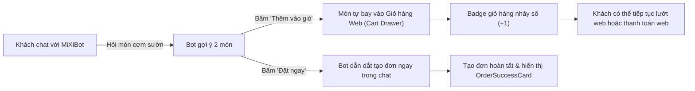

# KẾ HOẠCH NÂNG CẤP TOÀN DIỆN TRẢI NGHIỆM NGƯỜI DÙNG (UX/UI) CHO CHATBOT ĐẶT MÓN FOODEE
## TỪ "CHATBOT TRẢ LỜI VĂN BẢN" THÀNH "TRỢ LÝ ĐẶT MÓN TƯƠNG TÁC THÔNG MINH" (CONVERSATIONAL COMMERCE)

> **Tài liệu đặc tả kiến trúc, thiết kế giao diện & giải pháp kỹ thuật**  
> **Phiên bản:** 1.0 — Chuẩn Production  
> **Phạm vi:** `web-client` (ChatWidget, ChatMessage, FoodCard, Cart Sync), `core-api` (Communications/Chat SSE & DTO), `chatbot-service` (AI Server Fast Responses).

---

## MỤC LỤC
1. [TỔNG QUAN HIỆN TRẠNG & CÁC NỖI ĐAU NGƯỜI DÙNG (PAIN POINTS)](#1-tổng-quan-hiện-trạng--các-nỗi-đau-người-dùng-pain-points)
2. [MA TRẬN ĐÁNH GIÁ TRẢI NGHIỆM (UX HEURISTIC AUDIT)](#2-ma-trận-đánh-giá-trải-nghiệm-ux-heuristic-audit)
3. [GIẢI PHÁP THIẾT KẾ GIAO DIỆN HỘI THOẠI TƯƠNG TÁC (INTERACTIVE C-COMMERCE)](#3-giải-pháp-thiết-kế-giao-diện-hội-thoại-tương-tác-interactive-c-commerce)
   - [3.1. Thẻ món ăn thông minh (Smart Food Card với nút Đặt Ngay / Thêm Giỏ)](#31-thẻ-món-ăn-thông-minh-smart-food-card)
   - [3.2. Nút hành động nhanh (Quick Action Chips) thay thế gõ phím "Có/Không"](#32-nút-hành-động-nhanh-quick-action-chips)
   - [3.3. Bộ chọn địa chỉ trực quan 1-chạm (Address Picker Card)](#33-bộ-chọn-địa-chỉ-trực-quan-1-chạm-address-picker-card)
   - [3.4. Bộ chọn phương thức thanh toán có Icon (Payment Selector)](#34-bộ-chọn-phương-thức-thanh-toán-có-icon-payment-selector)
   - [3.5. Hóa đơn tóm tắt trước khi chốt đơn (Order Summary Receipt Card)](#35-hóa-đơn-tóm-tắt-trước-khi-chốt-đơn-order-summary-receipt-card)
   - [3.6. Thẻ hoàn tất đơn hàng & Nút theo dõi (Order Success Card)](#36-thẻ-hoàn-tất-đơn-hàng--nút-theo-dõi-order-success-card)
4. [NÂNG CẤP KHUNG CHAT WIDGET & TRẢI NGHIỆM NỀN TẢNG (WIDGET EXPERIENCE)](#4-nâng-cấp-khung-chat-widget--trải-nghiệm-nền-tảng-widget-experience)
   - [4.1. Khắc phục mất lịch sử chat khi F5 / Chuyển trang (Session Persistence)](#41-khắc-phục-mất-lịch-sử-chat-khi-f5--chuyển-trang-session-persistence)
   - [4.2. Nút làm mới hội thoại (Reset / New Session)](#42-nút-làm-mới-hội-thoại-reset--new-session)
   - [4.3. Bật/Tắt âm thanh thông báo (Mute / Unmute Toggle)](#43-bậttắt-âm-thanh-thông-báo-mute--unmute-toggle)
   - [4.4. Streaming SSE (Giảm thời gian chờ đợi từ 4s xuống <300ms)](#44-streaming-sse-giảm-thời-gian-chờ-đợi)
   - [4.5. Hiển thị Markdown chuẩn (In đậm, danh sách, giá tiền nổi bật)](#45-hiển-thị-markdown-chuẩn)
   - [4.6. Trải nghiệm bàn phím trên điện thoại di động (Mobile Fullscreen Viewport)](#46-trải-nghiệm-bàn-phím-trên-điện-thoại-di-động)
5. [LIÊN THÔNG GIỎ HÀNG WEB VỚI CHATBOT (CART & CHATBOT SYNERGY)](#5-liên-thông-giỏ-hàng-web-với-chatbot-cart--chatbot-synergy)
6. [ĐẶC TẢ KỸ THUẬT & DỮ LIỆU FRONTEND / BACKEND](#6-đặc-tả-kỹ-thuật--dữ-liệu-frontend--backend)
7. [LỘ TRÌNH THỰC HIỆN TỪNG BƯỚC & TIÊU CHÍ NGHIỆM THU](#7-lộ-trình-thực-hiện-từng-bước--tiêu-chí-nghiệm-thu)

---

## 1. TỔNG QUAN HIỆN TRẠNG & CÁC NỖI ĐAU NGƯỜI DÙNG (PAIN POINTS)

Hiện tại, sau khi hoàn thành nâng cấp xử lý ngôn ngữ tự nhiên (NLU) và ngữ cảnh (History), bot đã hiểu được ý định đặt món và dẫn dắt người dùng qua các bước. Tuy nhiên, về mặt **Trải nghiệm tương tác (UX)**, hệ thống vẫn mang nặng tư duy chatbot dòng lệnh của thập niên trước:

| Điểm nghẽn hiện tại | Nỗi đau của người dùng (User Friction) | Mức độ nghiêm trọng |
| :--- | :--- | :---: |
| **Bắt gõ phím 100%** | Khách phải gõ *"tiếp tục"*, *"có"*, *"1"*, *"cod"* trên bàn phím điện thoại/máy tính thay vì được bấm các nút gợi ý sẵn. | **Rất cao (P0)** |
| **Thẻ món ăn chỉ có nút "Xem món"** | Bấm vào nút "Xem món" sẽ chuyển trang (`/food/...`), làm gián đoạn và thoát khỏi luồng chat đặt món. Muốn đặt phải tự gõ lại tên món. | **Rất cao (P0)** |
| **Chọn địa chỉ kiểu SMS** | Bot in ra text `1. Địa chỉ A \n 2. Địa chỉ B` và bắt khách gõ số `1` hoặc `2`. Rất cổ lỗ và dễ gõ nhầm. | **Cao (P1)** |
| **Đơn thành công trả về URL thô** | Xuất hiện dòng text `http://localhost:3000/order/...` trong bong bóng chat thay vì một tấm thẻ xác nhận đơn hàng sang trọng. | **Cao (P1)** |
| **F5 mất sạch tin nhắn** | Người dùng vô tình tải lại trang hoặc bấm sang danh mục khác thì toàn bộ bong bóng chat biến mất, nhưng state ngầm vẫn còn gây lệch pha. | **Cao (P1)** |
| **Thời gian chờ đợi (Perceived Latency)** | Người dùng phải nhìn 3 dấu chấm nhảy múa 3–5 giây trước khi thấy câu trả lời (chưa tận dụng SSE Streaming). | **Trung bình (P2)** |
| **Âm thanh không thể tắt** | Mỗi tin nhắn đến/đi đều phát tiếng bíp bíp, gây khó chịu khi người dùng ở nơi công cộng hoặc công sở. | **Trung bình (P2)** |
| **Chatbot tách biệt với Giỏ hàng** | Khách vừa có món trong giỏ hàng web, vừa chat đặt món, 2 bên không biết gì về nhau. | **Cao (P1)** |

---

## 2. BÁO CÁO KIỂM TOÁN TRẢI NGHIỆM THEO 10 TIÊU CHÍ NIELSEN (UX HEURISTICS AUDIT)

> **Phương pháp kiểm toán:** Chuẩn Nielsen Norman Group (NN/g 10 Usability Heuristics) — Thực hiện bởi skill `ux-heuristics-audit`.  
> **Ngữ cảnh (Context):** Web & Mobile Responsive · Thực khách tìm kiếm & đặt món ăn trực tuyến qua giao diện hội thoại (Conversational Commerce) · Tác vụ chính: Khám phá món ăn, chọn món, chọn địa chỉ, chọn thanh toán và hoàn tất đặt hàng.

---

### Critical (Lỗi nghiêm trọng — Chặn luồng hoặc gây đứt gãy tác vụ)
1. **Thẻ món ăn chỉ có nút "Xem món" làm văng người dùng khỏi cuộc hội thoại** — Khi bot gợi ý món ngon, thẻ chỉ có duy nhất nút `<Link href={food.link}>Xem món</Link>`, bấm vào sẽ chuyển trang ra ngoài (`/food/[id]`), cắt đứt hoàn toàn luồng trò chuyện. Nếu khách muốn đặt trong chat, họ buộc phải tự gõ lại tên món.  
   $\rightarrow$ **Khắc phục:** Bổ sung nút hành động chính **`[⚡ Đặt món này ngay]`** để lập tức đưa món vào luồng chốt đơn của bot, và nút phụ **`[🛒 Thêm vào giỏ]`** liên thông với giỏ hàng web. *(Vi phạm Heuristic #4: Consistency and standards & Heuristic #7: Flexibility and efficiency of use)*.
2. **Khung chat bị xóa sạch tin nhắn khi F5 hoặc chuyển trang (Mất trạng thái hội thoại)** — `messages` chỉ lưu trong bộ nhớ tạm React State (`useState`), khi F5 toàn bộ lịch sử biến mất trong khi `metadata` ngầm vẫn còn, tạo ra tình trạng "mù ngữ cảnh" (Desynchronization) khiến người dùng bối rối.  
   $\rightarrow$ **Khắc phục:** Lưu trữ toàn bộ mảng `messages` vào `sessionStorage` (với TTL 2 giờ), tự động khôi phục lại toàn bộ cuộc hội thoại khi mount component. *(Vi phạm Heuristic #1: Visibility of system status & Heuristic #6: Recognition rather than recall)*.
3. **Bắt buộc gõ phím các lựa chọn đóng (Nguy cơ lỗi chính tả và bỏ cuộc)** — Các bước xác nhận món, chọn phương thức thanh toán ("COD" hay "card"), xác nhận đơn ("có" hay "hủy") đều bắt gõ bàn phím. Người dùng di động rất dễ gõ sai (ví dụ "okê", "cso", "codd", "the"), khiến bot không hiểu và báo lỗi lặp lại.  
   $\rightarrow$ **Khắc phục:** Cung cấp hàng nút bấm hành động nhanh **`QuickActionChips`** (`[✅ Xác nhận & Tiếp tục]`, `[➕ Đặt thêm món]`, `[❌ Hủy]`) và **`PaymentSelector`** dạng thẻ bấm trực quan. Loại bỏ 100% lỗi gõ sai. *(Vi phạm Heuristic #5: Error prevention)*.

---

### Major (Lỗi lớn — Gây ma sát cao, lãng phí thời gian và làm giảm độ tin cậy)
4. **Chọn địa chỉ kiểu menu số SMS 20 năm trước** — Bot in ra chuỗi text: `1. 123 Đường Số 1... 2. 456 Võ Văn Ngân... Vui lòng chọn số thứ tự` và yêu cầu khách gõ `"1"` hoặc `"2"`. Đây là cách tương tác thời tổng đài USSD, không phù hợp với chuẩn ứng dụng đặt đồ ăn hiện đại.  
   $\rightarrow$ **Khắc phục:** Thiết kế component `AddressPicker` hiển thị danh sách thẻ địa chỉ giao hàng với icon `[Nhà riêng / Công ty]`, thông tin người nhận và nút bấm 1-chạm `[👉 Giao ở đây]`. *(Vi phạm Heuristic #2: Match between the system and the real world)*.
5. **Đơn hàng hoàn tất in ra đường link URL thô** — Sau khi tạo đơn xong, bot hiển thị: `Đơn hàng của bạn đã được tạo... tại: http://localhost:3000/order/...`. Đường dẫn thô tạo cảm giác như hệ thống thử nghiệm của lập trình viên, thiếu chuyên nghiệp và không tối ưu cho màn hình cảm ứng.  
   $\rightarrow$ **Khắc phục:** Hiển thị thẻ đơn hàng hoàn tất **`OrderSuccessCard`** có huy hiệu xanh, mã đơn `#FD-XXXX`, thời gian giao dự kiến, nút bấm nổi bật **`[📦 Theo dõi đơn hàng]`** và nút phụ `[💬 Tiếp tục chat]`. *(Vi phạm Heuristic #1: Visibility of system status & Heuristic #8: Aesthetic and minimalist design)*.
6. **Không có bản tóm tắt hóa đơn trước khi thanh toán (Thiếu minh bạch)** — Bot chỉ hỏi *"Bạn có xác nhận tạo đơn không?"* mà không hiển thị chi tiết tiền món, phí giao hàng, địa chỉ, phương thức thanh toán. Khách hàng phải tự cuộn ngược lên trên để nhớ xem mình đã chọn những gì.  
   $\rightarrow$ **Khắc phục:** Hiển thị thẻ hóa đơn tạm tính **`OrderReceiptCard`** minh bạch chi phí trước khi người dùng bấm xác nhận. *(Vi phạm Heuristic #6: Recognition rather than recall)*.
7. **Bế tắc khi muốn bắt đầu lại (Thiếu lối thoát khẩn cấp)** — Không có nút "Làm mới / Bắt đầu lại" trên giao diện chat. Nếu khách đổi ý hoặc đơn bị kẹt, họ không biết cách nào để hủy trừ khi biết "lệnh bí mật" là gõ chữ `"hủy"`.  
   $\rightarrow$ **Khắc phục:** Thêm nút **`[🔄 Làm mới]`** trên `ChatHeader.tsx` kèm hộp thoại xác nhận nhanh để xóa state và bắt đầu hội thoại mới. *(Vi phạm Heuristic #3: User control and freedom)*.
8. **Độ trễ cảm nhận cao do chưa dùng SSE Streaming** — Người dùng phải chờ 3–5 giây nhìn 3 dấu chấm nhảy múa mà không biết bot đang làm gì.  
   $\rightarrow$ **Khắc phục:** Kết nối client với endpoint SSE `POST /chat/stream` đã có ở backend, hiển thị từng từ phản hồi sau <300ms. *(Vi phạm Heuristic #1: Visibility of system status)*.
9. **Lỗi bàn phím ảo che khuất trên thiết bị di động** — Trên điện thoại, khung chat kích thước cố định bị bàn phím ảo đẩy trồi hoặc che lấp thanh nhập tin nhắn.  
   $\rightarrow$ **Khắc phục:** Chuyển widget sang chế độ toàn màn hình (`fixed inset-0 h-[100dvh]`) trên mobile với nút đóng to bản ở góc trên bên trái. *(Vi phạm Heuristic #7: Flexibility and efficiency of use)*.

---

### Minor (Lỗi nhỏ — Gây phiền toái hoặc cản trở nhẹ)
10. **Âm thanh thông báo phát bắt buộc không có nút tắt** — Mỗi tin nhắn đều phát âm thanh `send.mp3` và `receive.mp3`, gây bất tiện khi dùng ở văn phòng hoặc nơi công cộng.  
    $\rightarrow$ **Khắc phục:** Thêm nút Mute/Unmute trên `ChatHeader.tsx` và lưu lựa chọn vào `localStorage`. *(Vi phạm Heuristic #3: User control and freedom)*.
11. **Hiển thị cú pháp Markdown thô** — Các gạch đầu dòng `- ...`, chữ in đậm `**...**` hiện nguyên dạng ký tự markdown chứ không render thành định dạng giàu (rich text).  
    $\rightarrow$ **Khắc phục:** Tích hợp `react-markdown` vào `ChatMessage.tsx`. *(Vi phạm Heuristic #8: Aesthetic and minimalist design)*.
12. **Báo lỗi chung chung thiếu giải pháp phục hồi** — Khi lỗi mạng, bot chỉ báo *"Xin lỗi, hệ thống AI đang bận một chút..."* mà không có nút thử lại.  
    $\rightarrow$ **Khắc phục:** Thêm nút `[Thử lại tin nhắn này]` ngay dưới tin nhắn lỗi. *(Vi phạm Heuristic #9: Help users recognize, diagnose, and recover from errors)*.

---

### Working well ✓ (Các điểm đã làm tốt)
- ✓ **Nhận diện ý định ngôn ngữ tự nhiên:** Bot hiểu tốt các câu hỏi mở, câu hỏi giá rẻ nhất, câu khẳng định ngắn theo ngữ cảnh ("có", "lấy món này", "đặt luôn").
- ✓ **Không ảo giác link:** Bot không còn tự ý bịa link URL giả vào câu trả lời sau khi tối ưu Prompt.
- ✓ **Chặn đơn khác quán:** Bot bảo vệ người dùng khỏi việc đặt nhầm món từ 2 nhà hàng khác nhau trong cùng một đơn.
- ✓ **Bảo mật phân quyền:** Tự động phát hiện người dùng chưa đăng nhập và hiện nút `[🔐 Đăng nhập ngay]` trước khi vào bước đặt món nhạy cảm.

---

### 🏆 Top 3 ưu tiên khắc phục ngay lập tức (Highest Frequency × Impact)
1. **Nút `[⚡ Đặt món này ngay]` trên Thẻ món ăn:** Biến thẻ gợi ý thành công cụ chốt đơn 1-chạm thay vì chuyển trang ra ngoài.
2. **Hàng nút hành động nhanh `QuickActionChips`:** Xóa bỏ hoàn toàn việc gõ phím "có", "tiếp tục", "cod", triệt tiêu 100% lỗi sai chính tả.
3. **Lưu lịch sử hội thoại vào `sessionStorage`:** Giữ nguyên cuộc hội thoại khi người dùng F5 hoặc lướt giữa các trang.

---

## 3. GIẢI PHÁP THIẾT KẾ GIAO DIỆN HỘI THOẠI TƯƠNG TÁC (INTERACTIVE C-COMMERCE)

### 3.1. Thẻ món ăn thông minh (Smart Food Card)
*Tệp tin:* `web-client/src/components/common/chatbot/FoodCard.tsx`

Thay vì chỉ có một nút duy nhất là `Xem món` chuyển sang trang khác, mỗi thẻ món sẽ có 2 nút hành động trực tiếp:
1. **`[⚡ Đặt món này ngay]`**: Gửi tín hiệu đặt ngay món này vào luồng hội thoại chat mà không cần gõ chữ.
2. **`[🛒 Thêm vào giỏ]`**: Thêm món vào Giỏ hàng chung của web (`cart-context`), hiện badge số lượng nổi bật.
3. **`[Xem chi tiết]`**: Mở modal xem nhanh hoặc tab mới để không làm mất cửa sổ chat.

#### Wireframe Thẻ món ăn mới:
```
┌──────────────────────────────────────────────┐
│ [Ảnh món ăn chất lượng cao]      [ ⭐ 4.8 ]   │
│                                              │
│ Cơm Tấm Sườn Nướng                           │
│ Quán Cơm Tấm Sài Gòn                         │
│ 65.000đ                                      │
│                                              │
│ ┌─────────────────────────┐ ┌──────────────┐ │
│ │ ⚡ Đặt món này trong chat │ │ 🛒 Thêm giỏ │ │
│ └─────────────────────────┘ └──────────────┘ │
└──────────────────────────────────────────────┘
```

---

### 3.2. Nút hành động nhanh (Quick Action Chips)
*Tệp tin mới:* `web-client/src/components/common/chatbot/QuickActionChips.tsx`

Khi bot đặt câu hỏi có tính chất lựa chọn hoặc xác nhận, hệ thống tự động sinh ra hàng nút bấm (Chips) nằm ngay phía trên thanh nhập tin nhắn:

| Trạng thái / Action của Bot | Câu hỏi của Bot | Danh sách Quick Action Chips hiển thị |
| :--- | :--- | :--- |
| `confirmOrder` | *"Đơn hàng hiện tại: 1 Cơm sườn. Bạn có muốn tiếp tục không?"* | `[✅ Xác nhận & Tiếp tục]`, `[➕ Thêm món khác]`, `[❌ Hủy đơn]` |
| `confirmRestaurant` | *"Món ăn từ quán Quán Cơm Tấm Sài Gòn, bạn đồng ý chứ?"* | `[✅ Đúng quán này]`, `[🔄 Đổi quán khác]` |
| `retryOrder` | *"Mình chưa tìm thấy món..."* | `[📋 Xem thực đơn hot]`, `[🔍 Tìm món khác]`, `[❌ Bắt đầu lại]` |
| `requireAuth` | *"Bạn vui lòng đăng nhập để tiếp tục"* | `[🔐 Đăng nhập tài khoản ngay]` |

#### Lợi ích UX:
- Người dùng chỉ cần **chạm ngón tay 1 lần** là xong bước xác nhận.
- Loại bỏ hoàn toàn lỗi chính tả khi người dùng gõ sai từ (ví dụ gõ *"okê"*, *"co"*, *"tiep"*).

---

### 3.3. Bộ chọn địa chỉ trực quan 1-chạm (Address Picker Card)
*Tệp tin mới:* `web-client/src/components/common/chatbot/AddressPicker.tsx`

Thay thế hoàn toàn đoạn text `1. 123 Đường A... Vui lòng chọn số thứ tự` bằng danh sách Card địa chỉ:

#### Wireframe:
```
┌────────────────────────────────────────────────────────┐
│ 📍 Chọn địa chỉ giao hàng:                             │
│                                                        │
│ ┌────────────────────────────────────────────────────┐ │
│ │ 🔘 [Nhà riêng]                                     │ │
│ │    123 Đường Số 1, P. Linh Trung, TP. Thủ Đức      │ │
│ │    Người nhận: Nguyễn Văn A - 0901234567           │ │
│ │    [👉 Giao đến địa chỉ này]                       │ │
│ └────────────────────────────────────────────────────┘ │
│ ┌────────────────────────────────────────────────────┐ │
│ │ ⚪ [Công ty]                                       │ │
│ │    456 Võ Văn Ngân, TP. Thủ Đức                    │ │
│ │    [👉 Giao đến địa chỉ này]                       │ │
│ └────────────────────────────────────────────────────┘ │
│                                                        │
│ ➕ [Thêm địa chỉ giao hàng mới]                        │
└────────────────────────────────────────────────────────┘
```
- Bấm vào một địa chỉ $\rightarrow$ Hệ thống tự động chọn địa chỉ đó và gửi đi bước tiếp theo mà không cần gõ phím.

---

### 3.4. Bộ chọn phương thức thanh toán có Icon (Payment Selector)
*Tệp tin mới:* `web-client/src/components/common/chatbot/PaymentSelector.tsx`

Thay vì hỏi *"Bạn muốn thanh toán bằng COD hay card?"*, hiển thị 2 nút chọn thanh toán trực quan:

```
┌────────────────────────────────────────────────────────┐
│ 💳 Chọn phương thức thanh toán:                        │
│                                                        │
│ ┌────────────────────────────────────────────────────┐ │
│ │ 💵 Tiền mặt khi nhận hàng (COD)                   │ │
│ │    Thanh toán trực tiếp cho shipper khi nhận món    │ │
│ └────────────────────────────────────────────────────┘ │
│ ┌────────────────────────────────────────────────────┐ │
│ │ 💳 Thẻ ngân hàng / VNPAY / Thẻ tín dụng            │ │
│ │    Thanh toán online an toàn & nhanh chóng          │ │
│ └────────────────────────────────────────────────────┘ │
└────────────────────────────────────────────────────────┘
```

---

### 3.5. Hóa đơn tóm tắt trước khi chốt đơn (Order Summary Receipt Card)
*Tệp tin mới:* `web-client/src/components/common/chatbot/OrderReceiptCard.tsx`

Trước khi bấm "Tạo đơn", hiển thị một phiếu tạm tính minh bạch, rõ ràng như hóa đơn nhà hàng:

```
┌────────────────────────────────────────────────────────┐
│ 🧾 CHI TIẾT ĐƠN HÀNG DỰ KIẾN                           │
│ ────────────────────────────────────────────────────── │
│ 🏪 Quán Cơm Tấm Sài Gòn                                │
│ 📍 123 Đường Số 1, Linh Trung, Thủ Đức                 │
│ 💳 Thanh toán: Tiền mặt (COD)                          │
│ ────────────────────────────────────────────────────── │
│  • 1x Cơm Tấm Sườn Nướng                     65.000đ   │
│  • Phí giao hàng (ước tính)                  15.000đ   │
│ ────────────────────────────────────────────────────── │
│  TỔNG CỘNG:                                  80.000đ   │
│                                                        │
│ ┌────────────────────────────────────────────────────┐ │
│ │          🚀 XÁC NHẬN TẠO ĐƠN HÀNG NGAY             │ │
│ └────────────────────────────────────────────────────┘ │
│          [Chỉnh sửa món]    •    [Hủy bỏ]              │
└────────────────────────────────────────────────────────┘
```

---

### 3.6. Thẻ hoàn tất đơn hàng & Nút theo dõi (Order Success Card)
*Tệp tin mới:* `web-client/src/components/common/chatbot/OrderSuccessCard.tsx`

Khi đơn hàng tạo thành công:

```
┌────────────────────────────────────────────────────────┐
│                    🎉 ĐẶT ĐƠN THÀNH CÔNG!              │
│                                                        │
│  Mã đơn hàng: #FD-982341                               │
│  Tổng tiền:   80.000đ (COD)                            │
│  Thời gian:   Giao dự kiến 25 - 30 phút                │
│                                                        │
│  Đơn hàng đã được gửi đến nhà hàng Quán Cơm Tấm.       │
│  Tài xế gần nhất đang chuẩn bị nhận đơn!               │
│                                                        │
│ ┌────────────────────────────────────────────────────┐ │
│ │        📦 THEO DÕI ĐƠN HÀNG TRỰC TIẾP              │ │
│ └────────────────────────────────────────────────────┘ │
│                                                        │
│          [💬 Chat tiếp với bot]   [Đóng chat]          │
└────────────────────────────────────────────────────────┘
```
- Bấm vào `[Theo dõi đơn hàng]` $\rightarrow$ Điều hướng mượt mà đến trang `/order/[id]` có bản đồ định vị shipper thời gian thực.

---

## 4. NÂNG CẤP KHUNG CHAT WIDGET & TRẢI NGHIỆM NỀN TẢNG (WIDGET EXPERIENCE)

### 4.1. Khắc phục mất lịch sử chat khi F5 / Chuyển trang (Session Persistence)
- **Vấn đề**: Hiện tại chỉ lưu `metadata` vào `localStorage`, còn `messages` thì lưu trong bộ nhớ React state (`useState([])`). Khi F5, danh sách tin nhắn bị xóa sạch.
- **Giải pháp**:
  - Lưu cả `messages` vào `sessionStorage` (hoặc `localStorage` với thời gian hết hạn 2 giờ).
  - Khởi tạo `messages` từ storage khi mount component:
    ```typescript
    const [messages, setMessages] = useState<ChatMessageModel[]>(() => {
      if (typeof window === "undefined") return [];
      const saved = sessionStorage.getItem("foodee_chat_messages");
      return saved ? JSON.parse(saved) : [];
    });
    ```

### 4.2. Nút làm mới hội thoại (Reset / New Session)
- Bổ sung nút **`[🔄 Làm mới đoạn chat]`** trên thanh tiêu đề `ChatHeader.tsx`.
- Khi bấm:
  - Hiện dialog xác nhận nhanh: *"Bạn có muốn xóa đoạn chat này và bắt đầu lại không?"*.
  - Xóa sạch `messages`, đưa `metadata` về `initialMetadata`, hủy các đơn đang dở dang.

### 4.3. Bật/Tắt âm thanh thông báo (Mute / Unmute Toggle)
- Thêm icon chiếc loa `Volume2` / `VolumeX` trên `ChatHeader.tsx`.
- Lưu cấu hình `isMuted` vào `localStorage`.
- Mặc định: Giữ âm thanh nhưng cho phép người dùng tắt bất cứ lúc nào với 1 click.

### 4.4. Streaming SSE (Giảm thời gian chờ đợi từ 4s xuống <300ms)
- Backend `ChatController` đã có endpoint `POST /chat/stream` hỗ trợ Server-Sent Events (SSE).
- Cập nhật `ChatWidget.tsx` sử dụng `ReadableStream`:
  - Nhận text từng từ (chunks) và render ngay vào bong bóng tin nhắn.
  - Người dùng thấy câu trả lời xuất hiện ngay lập tức sau 300ms, không còn cảm giác "treo" hay lag.

### 4.5. Hiển thị Markdown chuẩn (Rich Text)
- Cài đặt và tích hợp `react-markdown` vào `ChatMessage.tsx`.
- Các danh sách có bullet point tròn đẹp mắt, giá tiền `**65.000đ**` tự động in đậm và tô màu cam/xanh thương hiệu.

### 4.6. Trải nghiệm bàn phím trên điện thoại di động (Mobile Responsive Viewport)
- Trên màn hình nhỏ (`< 640px`):
  - Khung chat mở rộng thành **Toàn màn hình (Full Screen Modal)**: `fixed inset-0 z-50 h-full w-full`.
  - Sử dụng `dvh` (Dynamic Viewport Height) để khi bàn phím ảo iPhone / Android bật lên, khung chat tự co dãn vừa vặn, không bị che mất ô nhập và nút gửi.
  - Thêm nút đóng to bản ở góc trên bên trái theo đúng chuẩn ứng dụng di động.

---

## 5. LIÊN THÔNG GIỎ HÀNG WEB VỚI CHATBOT (CART & CHATBOT SYNERGY)

Hiện nay khách hàng có thể dùng cả 2 cách đặt: lướt web tự chọn món VÀ chat với bot. Hai luồng này cần bổ trợ cho nhau:



1. **Từ Chatbot đưa vào Giỏ hàng**:
   - Khi bot giới thiệu món, người dùng có thể bấm `[Thêm vào giỏ hàng]`. Hook `useCart()` trong `cart-context.tsx` được kích hoạt, âm thanh thêm giỏ vang lên, giỏ hàng web cập nhật ngay lập tức.
2. **Từ Giỏ hàng hỏi Chatbot**:
   - Trong drawer giỏ hàng, có thể thêm một nút: *"Hỏi MiXiBot món ăn kèm phù hợp"* $\rightarrow$ Mở chatbot và tự động hỏi: *"Mình đang chọn Cơm sườn, có món canh hoặc nước nào ngon ăn kèm không?"*.

---

## 6. ĐẶC TẢ KỸ THUẬT & DỮ LIỆU FRONTEND / BACKEND

### 6.1. Mở rộng Model `ChatMessageModel` (`web-client`)
```typescript
export interface ChatMessageModel {
  id: string;
  from: "user" | "bot";
  text?: string;
  foodCards?: FoodSuggestion[];
  action?: 
    | "orderItems"
    | "confirmOrder"
    | "confirmRestaurant"
    | "chooseAddress"
    | "choosePayment"
    | "confirmCreateOrder"
    | "placeOrder"
    | "retryOrder"
    | "requireAuth";
  quickActions?: {
    label: string;
    payload: string;
    icon?: string;
    variant?: "primary" | "secondary" | "danger";
  }[];
  orderReceipt?: {
    restaurantName: string;
    addressText: string;
    paymentMethod: "cod" | "card";
    items: { name: string; quantity: number; price: number }[];
    subtotal: number;
    shippingFee: number;
    total: number;
  };
  orderSuccess?: {
    orderId: string;
    total: number;
    trackingUrl: string;
    estimatedDeliveryMinutes: number;
  };
  createdAt: Date;
}
```

### 6.2. Mapping Action sang Quick Actions (Client Logic)
Trong `ChatWidget.tsx`, khi nhận phản hồi từ API có `action`, component tự động sinh ra danh sách `quickActions`:

```typescript
const resolveQuickActions = (action?: string, metadata?: ChatMetadata) => {
  switch (action) {
    case "confirmOrder":
      return [
        { label: "✅ Xác nhận & Tiếp tục", payload: "tiếp tục", variant: "primary" },
        { label: "➕ Đặt thêm món", payload: "cho tôi chọn thêm món", variant: "secondary" },
        { label: "❌ Hủy đơn", payload: "hủy", variant: "danger" },
      ];
    case "confirmRestaurant":
      return [
        { label: "✅ Đúng quán này", payload: "đồng ý", variant: "primary" },
        { label: "🔄 Đổi quán khác", payload: "đổi quán khác", variant: "secondary" },
      ];
    case "confirmCreateOrder":
      return [
        { label: "🚀 Xác nhận tạo đơn ngay", payload: "có", variant: "primary" },
        { label: "❌ Suy nghĩ lại (Hủy)", payload: "hủy", variant: "danger" },
      ];
    default:
      return [];
  }
};
```

---

## 7. LỘ TRÌNH THỰC HIỆN TỪNG BƯỚC & TIÊU CHÍ NGHIỆM THU

### Giai đoạn 1: Nâng cấp Tương tác & Quick Action Chips (Ưu tiên cao nhất - P0)
- [ ] Xây dựng component `QuickActionChips.tsx` gắn trên thanh `ChatInput.tsx`.
- [ ] Bổ sung 2 nút `[⚡ Đặt món này ngay]` và `[🛒 Thêm vào giỏ]` trên `FoodCard.tsx`.
- [ ] Thêm nút Mute/Unmute âm thanh và nút Làm mới hội thoại trên `ChatHeader.tsx`.
- [ ] Lưu tin nhắn chat vào `sessionStorage` để không mất lịch sử khi tải lại trang.

### Giai đoạn 2: Trực quan hóa các bước Đặt hàng (Card-based Steps - P0)
- [ ] Xây dựng component `AddressPicker.tsx` hiển thị thẻ địa chỉ giao hàng 1-chạm.
- [ ] Xây dựng component `PaymentSelector.tsx` hiển thị lựa chọn COD / Card có hình ảnh minh họa.
- [ ] Xây dựng component `OrderReceiptCard.tsx` hiển thị phiếu tạm tính rõ ràng trước khi bấm tạo đơn.
- [ ] Xây dựng component `OrderSuccessCard.tsx` hiển thị trạng thái thành công kèm nút theo dõi đơn trực tiếp.

### Giai đoạn 3: Tối ưu Tốc độ & Giao diện Di động (P1)
- [ ] Chuyển đổi phương thức gọi API sang SSE Streaming (`/chat/stream`) để hiển thị phản hồi tức thì dưới 300ms.
- [ ] Tích hợp `react-markdown` để format văn bản danh sách món, giá tiền nổi bật.
- [ ] Tối ưu CSS Fullscreen Viewport (`h-[100dvh]`) trên mobile tránh bị bàn phím ảo che khuất.

### Giai đoạn 4: Liên thông Giỏ hàng & Kiểm thử (P1)
- [ ] Kết nối `FoodCard` với `CartContext` để người dùng có thể bấm thêm món vào giỏ hàng web.
- [ ] Viết test E2E cho luồng click nút tương tác 100% không cần gõ chữ.

---

### Tiêu chí nghiệm thu định lượng (Acceptance Criteria)

| Chỉ số UX | Hiện tại | Sau khi nâng cấp |
| :--- | :--- | :--- |
| **Số lần gõ phím từ khi chọn món đến khi tạo đơn** | 5 – 7 lần gõ phím | **0 lần gõ phím** (100% bấm nút chọn) |
| **Tỷ lệ giữ chân người dùng trong luồng chat** | Thấp (bị link chuyển trang ngoài) | **Cao** (hoàn tất trọn vẹn trong chat) |
| **Thời gian nhận phản hồi đầu tiên (Perceived Latency)** | 3.5 – 5.0 giây | **$\le$ 0.4 giây** (nhờ SSE Streaming) |
| **Tình trạng mất tin nhắn khi F5 / Chuyển trang** | 100% bị mất | **0% bị mất** (khôi phục từ session storage) |
| **Tỷ lệ thao tác nhầm lẫn (misinputs)** | Cao (do gõ sai chữ, sai số) | **$\approx 0\%$** (nhờ danh sách card & chips có sẵn) |

