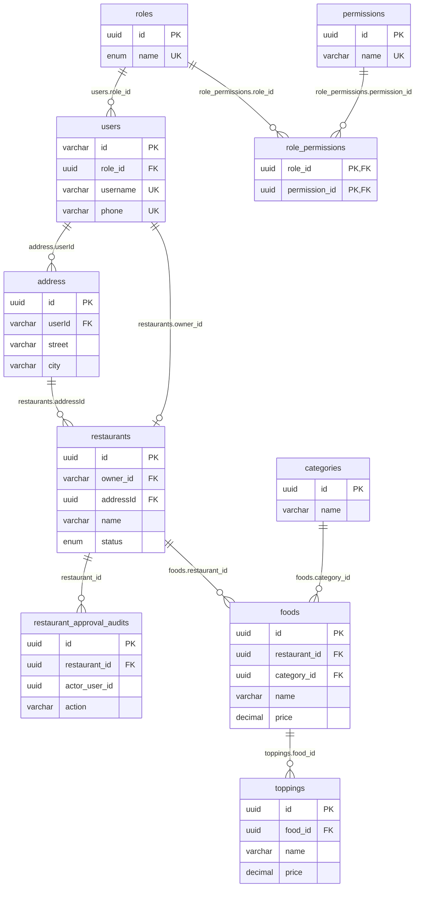
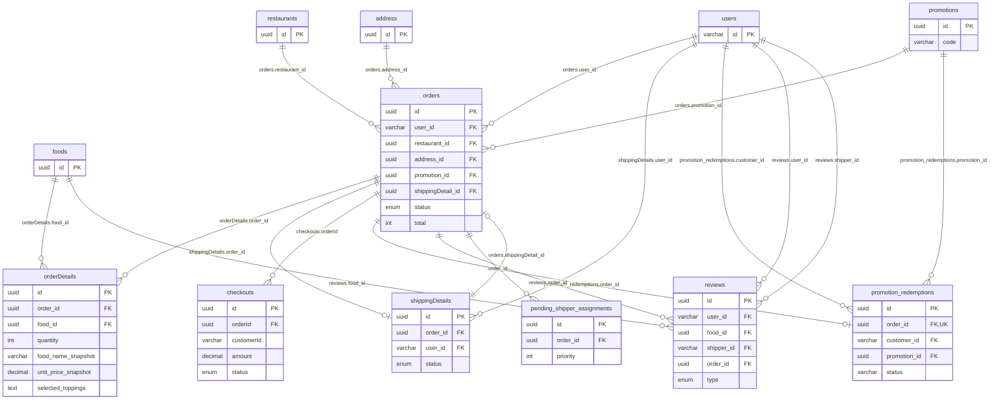
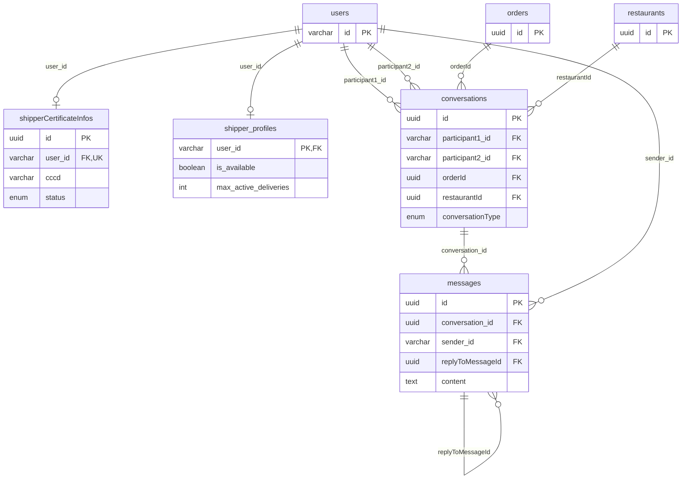
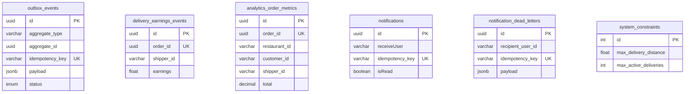

# ERD Foodee từ entity và migration

Sơ đồ này mô tả **PostgreSQL schema dự kiến sau khi chạy đủ migration**: 28 bảng nghiệp vụ được tạo qua 37 migration trong [`src/migrations`](../core-api/src/migrations). Mã nguồn có 27 entity class, nhưng [`entity-registry.ts`](../core-api/src/infra/database/entity-registry.ts) chỉ đăng ký 26; `promotion_redemptions` có entity và migration riêng, còn `role_permissions` là bảng nối Many-to-Many. Đây là bản đọc mã nguồn, **chưa đối chiếu với database đang chạy**. Tên bảng/cột giữ nguyên chữ hoa, chữ thường của PostgreSQL; ví dụ `address`, `orderDetails`, `shippingDetails` là tên thực tế trong migration. Bảng bookkeeping `migrations` của TypeORM không tính vào 28 bảng nghiệp vụ.

Ký hiệu `PK` là khóa chính, `FK` là khóa ngoại, `UK` là duy nhất. Các bảng được lặp lại giữa các sơ đồ chỉ để dễ đọc. Đường nối chỉ biểu diễn **FK có trong migration**. Một cột có tên `...Id` mà không có FK được liệt kê ở cuối tài liệu.

## 1. Tài khoản, phân quyền và thực đơn

`categories` là danh mục chung: bảng này **không có `restaurant_id`**. `restaurant_approval_audits.actor_user_id` là `uuid`, còn `users.id` là `varchar(28)`; migration chỉ tạo index, không tạo FK tới `users`. Một `owner_id` có ràng buộc unique nên hiện một user sở hữu tối đa một restaurant qua cột đó.

## 2. Đặt hàng, thanh toán, khuyến mãi và đánh giá

Hai bảng `orders` và `shippingDetails` đang giữ **hai FK ngược chiều**, mỗi cột có unique để biểu diễn 1–1. Đây là cấu trúc hiện tại trong migration, không phải hai quan hệ giao hàng khác nhau. `checkouts.orderId` vẫn có FK tới `orders`, dù entity Payment chỉ khai báo cột scalar; một order có thể có nhiều checkout. `checkouts.customerId` là snapshot, không có FK tới `users`. Topping đã chọn được lưu trong `orderDetails.selected_toppings` dạng JSON, không có bảng nối tới `toppings`.

Đánh giá không bị giới hạn thành “một review cho mỗi order”. Migration tạo unique có điều kiện theo `(order_id, user_id, food_id)` cho review món và `(order_id, user_id, shipper_id)` cho review tài xế; `reviews.order_id` cho dữ liệu cũ vẫn nullable.

## 3. Hồ sơ tài xế và hội thoại

`shipperCertificateInfos` và `shipper_profiles` đều nối với `users`, nhưng **không có FK trực tiếp giữa hai bảng**. `shipper_profiles` là mô hình Delivery mới; migration còn giữ các cột thống kê tài xế cũ trong `users` để tương thích.

## 4. Bảng sự kiện, projection và cấu hình độc lập

Các bảng ở phần này **không có FK tới bảng nghiệp vụ khác** theo migration hiện tại. `order_id`, `shipper_id`, `aggregate_id`, `receiveUser` và `recipient_user_id` là tham chiếu logic hoặc snapshot, không được PostgreSQL cưỡng chế bằng FK. `outbox_events.aggregate_id` còn phụ thuộc `aggregate_type`, nên không thể coi mặc định là `orders.id`.

## Điểm cần kiểm tra khi so với database thật

1. Chạy `SELECT id, timestamp, name FROM migrations ORDER BY timestamp;` để biết môi trường đã áp dụng đến migration nào. Nếu chưa chạy hết, ERD này có thể khác schema thật.
2. Đối chiếu ràng buộc FK thực tế bằng `pg_constraint`; các entity TypeORM và migration có chỗ biểu diễn khác nhau, rõ nhất là `checkouts.orderId`, `reviews.order_id` và `promotion_redemptions.customer_id`.
3. [`PromotionRedemption`](../core-api/src/entities/promotion-redemption.entity.ts) chưa có trong `DATABASE_ENTITIES` và [`autoLoadEntities`](../core-api/src/infra/database/database.options.ts) được đặt `false`. Migration vẫn tạo bảng, nhưng đường truy cập repository TypeORM của entity này cần được kiểm tra và sửa riêng trước khi coi tính năng áp mã là ổn định.
4. Tài liệu [`DATABASE_DESIGN.md`](DATABASE_DESIGN.md) là mô tả kiến trúc cũ; một số tên bảng, cardinality và quan hệ ở đó không đúng với migration hiện tại. Dùng sơ đồ này khi cần đối chiếu database triển khai.
